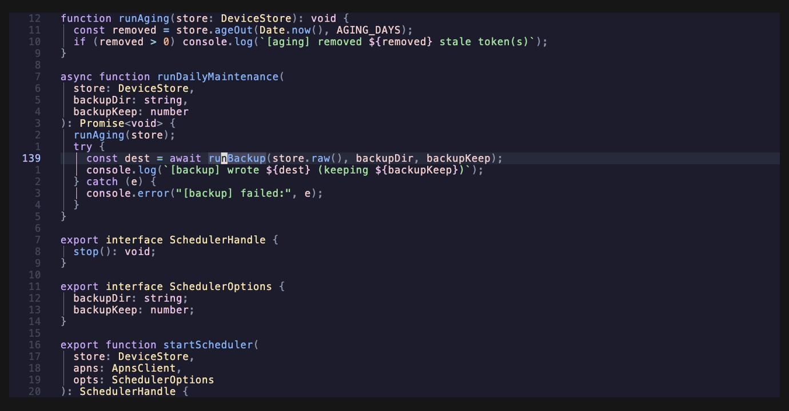

# whatsthis.nvim

Press a key on any code in Neovim and get a short AI explanation in a popup.



What it explains depends on where the cursor is:

- On a visual selection, it explains the selection.
- Inside a function, method or class, it explains the whole thing.
- On a call to a function in another file, it explains that function. It finds it through your language server, so you never leave the file you're reading.

It runs a CLI you already use, [pi](https://github.com/badlogic/pi-mono) or [Claude Code](https://docs.anthropic.com/en/docs/claude-code), so you don't need an API key. Answers take 3 to 5 seconds.

## Install

You need Neovim 0.11 or newer, and `pi` or `claude` on your `PATH`. With [lazy.nvim](https://github.com/folke/lazy.nvim):

```lua
{
  "julianbonomini/whatsthis.nvim",
  lazy = false,
  opts = {},
  keys = {
    { "<leader>ae", "<Plug>(WhatsThis)", mode = { "n", "x" }, desc = "What's this?" },
  },
}
```

`:WhatsThis` does the same, and `:'<,'>WhatsThis` explains a range of lines. Press the key again to move into the popup. `q` closes it and stops the request. Run `:checkhealth whatsthis` if nothing happens.

## Configuration

```lua
opts = {
  runner = "claude", -- default is "pi"
  runners = { claude = { model = "sonnet" } },
}
```

The window size, the prompt and how to add your own CLI are in [config.lua](lua/whatsthis/config.lua).

The code you explain is sent to whichever model provider your CLI uses.

## License

MIT
